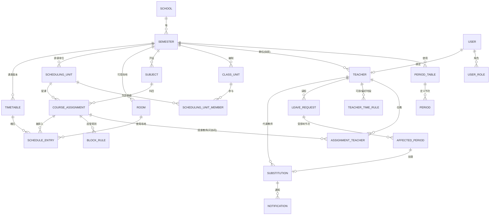
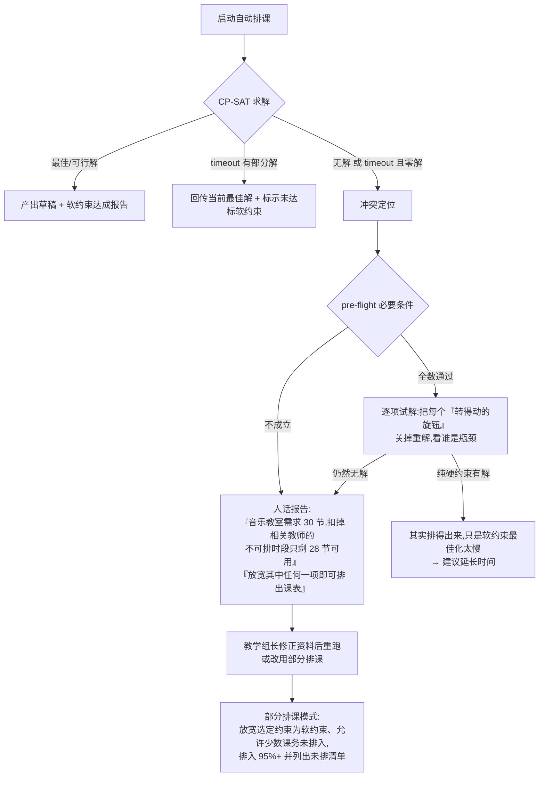
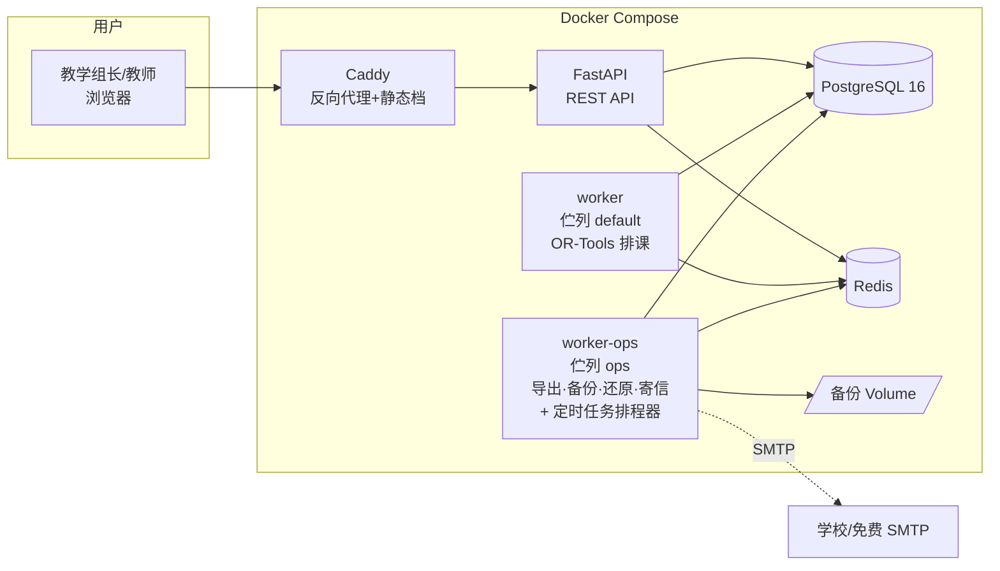
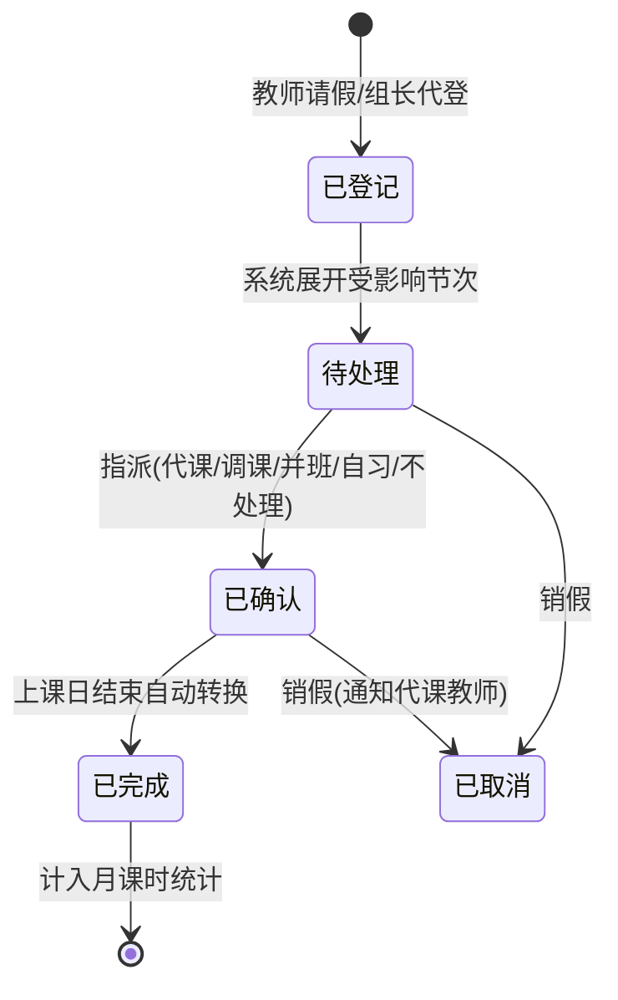

# 排课与调代课系统 — 架构规划文件

> 版本:v1.0(2026-07-07)
> 状态:规划定稿,交棒开发依据 [tasks.md](tasks.md)
> 授权:MIT
> 已定技术栈:**Python 3.12 + FastAPI + OR-Tools CP-SAT + Vue 3 + PostgreSQL 16 + Docker Compose**

---

## 0. 专案定位

一套**开源免费、单校自架、纯 Web** 的排课与调代课系统,服务对象为全小学学、初中、普通型高中、综合型高中、技术型高中的**教学组长**(主要操作者)、教务主任(审核/查看)与一般教师(查课表、请假、接代课通知)。

三大设计原则(所有后续决策的最高准则):

1. **不写死学制**:五种学制的差异一律化约为「可设置的资料」(自订节次表、弹性排课单位、可调约束),而非分支程序逻辑;以「学制范本」让用户一键初始化。
2. **一键部署**:`docker compose up -d` 一行指令完成安装;所有维运(备份、还原、升级)都有 UI 按钮或单行指令。
3. **30 分钟上手**:首次登录进入「设置精灵」,一步一步完成建置;所有界面使用台湾教务惯用语(节次、科任、配课、课时)。

---

## 1. 需求规格书

### 1.1 用户角色与权限矩阵

| 功能 | 系统管理员 | 教学组长 | 教务主任 | 教师 |
|---|---|---|---|---|
| 系统设置、帐号管理、备份还原 | ✅ | — | — | — |
| 基础资料维护(节次表/教师/班级/科目/场地) | ✅ | ✅ | 查看 | — |
| 配课与排课(手动+自动) | ✅ | ✅ | 查看 | — |
| 课表发布 | ✅ | ✅ | 核可(可设置是否需要) | — |
| 调代课安排 | ✅ | ✅ | 查看 | 回应代课邀请 |
| 请假登记 | ✅ | ✅(可代登) | 查看 | ✅(登记本人) |
| 查询课表(班级/教师/场地) | ✅ | ✅ | ✅ | ✅(全校可见或仅本人,可设置) |
| 课时统计报表 | ✅ | ✅ | ✅ | 仅本人 |

- 角色采 RBAC,一人可兼多角色(例:教学组长同时是教师)。
- 「教务主任核可」为可开关的流程节点,默认关闭(多数学校由教学组长直接发布)。

### 1.2 User Story 清单

优先级:**MVP**(M0–M5 必做)/ **v2** / **v3**。

#### A. 系统建置与基础资料

| # | User Story | 优先级 |
|---|---|---|
| A1 | 身为信息组长,我能用一行 Docker 指令架好系统,并用默认管理员帐号登录 | MVP |
| A2 | 身为教学组长,首次登录有设置精灵:选学制范本 → 设置学年学期 → 自订节次表 → 导入教师/班级/科目 → 完成 | MVP |
| A3 | 身为教学组长,我能自订节次表(每天节数、每节起讫时间、午休、早自习、周三下午不排课等) | MVP |
| A4 | 身为教学组长,我能用 Excel 范本批次导入教师(姓名、任教科目、基本课时、行政职减课)与班级 | MVP |
| A5 | 身为教学组长,我能维护场地(普通教室、专科教室、实习工场,含容量与适用科目) | MVP |
| A6 | 身为管理员,我能批次建立教师帐号并发送启用通知 | MVP |
| A7 | 身为教学组长,我能开新学期并复制上学期的基础资料(教师/班级/科目/节次表) | MVP |
| A8 | 身为管理员,我能整合教育云端帐号(OpenID Connect)登录 | v2 |

#### B. 配课

| # | User Story | 优先级 |
|---|---|---|
| B1 | 身为教学组长,我能建立配课:排课单位 × 科目 × 教师(可多位协同)× 每周节数 × 连堂规则 × 场地需求 | MVP |
| B2 | 身为教学组长,我能建立「跑班群组」(多班联排,如高中多元选修、综高学程),群组内课程同时段开课 | MVP |
| B3 | 身为教学组长,我能看到每位教师的配课节数统计,即时对照基本课时(超课时/不足以颜色标示) | MVP |
| A0 | 身为评估这套系统的人,我能在全新系统上一键载入示范资料(18 班初中、48 位教师、384 笔配课),不必先手 key 几百笔就能试跑自动排课。规格见 `app/data/demo_school.json`,只在「尚无任何学期」时可执行 | v1.2 |
| B3-1 | 身为管理员,我能设置「超课时上限」(默认 8 节),配课超出「应授 + 上限」时系统挡下并指名是谁。上限是相对值而非固定节数,因为应授本身因身分而异(台南市:国文专任 16、兼任导师 11、兼任主任 6)。**未填基本课时的教师不受管制**——`base_periods=0` 代表资料未建立,不是真的不用上课,硬挡会让未维护基钟的学校连一般配课都做不了 | v1.2 |
| B4 | 身为教学组长,我能用 Excel 批次导入配课资料 | MVP |
| B5 | 身为教学组长,我能设置教师「不可排课时段」(兼行政、公假、进修)与「偏好时段」 | MVP |

#### C. 排课

| # | User Story | 优先级 |
|---|---|---|
| C1 | 身为教学组长,我能在周课表格子上以拖拉方式手动排课,冲突格位即时以红色提示并说明原因 | MVP |
| C2 | 身为教学组长,我能切换班级/教师/场地三种课表视角 | MVP |
| C3 | 身为教学组长,我能一键自动排课,看到进度,并在完成后看到软约束达成度报告 | MVP |
| C4 | 身为教学组长,我能「锁定」部分格位(如已敲定的科任时段),自动排课不得移动 | MVP |
| C5 | 身为教学组长,自动排课无解时,系统告诉我最可能冲突的约束(如「王老师配课 22 节但可排时段仅 20 格」) | MVP |
| C6 | 身为教学组长,我能保留多个课表草稿版本,比较后选一个发布 | MVP |
| C7 | 身为教学组长,发布后全校师生可查询课表 | MVP |
| C8 | 身为教学组长,我能对已发布课表做局部调整并重新发布(保留历次版本) | MVP |
| C9 | 身为教学组长,我能设置进阶软约束权重(科目分布均匀、教师空堂集中等) | v2 |

#### D. 调代课

| # | User Story | 优先级 |
|---|---|---|
| D1 | 身为教师,我能登记请假(日期范围、假别),系统自动列出受影响节次 | MVP |
| D2 | 身为教学组长,我能替教师代登请假 | MVP |
| D3 | 身为教学组长,对每一受影响节次,我能选择处理方式:代课/调课(对调)/并班/自习/公假不处理 | MVP |
| D4 | 身为教学组长,系统推荐可代课教师(该时段空堂 → 同科目优先 → 当日已在校 → 代课课时平衡),一键指派 | MVP |
| D5 | 身为被指派教师,我会收到站内通知与 Email,可一键「确认收到」(实务上组长指派前已口头征得同意,故**不设婉拒流程**,2026-07-09 用户定案) | MVP |
| D6 | 身为教学组长,我能看到每笔代课通知的确认状态,对未确认者一键再次提醒 | MVP |
| D7 | 身为教学组长,我能查看任一日期的「今日调代课看板」,打印当日调代课通知单 | MVP |
| D8 | 身为教学组长,我能设置调课(甲乙教师对调两节课),系统验证双方均无冲突 | MVP |
| D9 | 身为教学组长,月底我能导出代课课时统计表(依教师、依假别、依经费来源) | MVP |
| D10 | 身为教师,我能在手机浏览器顺利完成「查课表、请假、确认代课」 | MVP |
| D11 | 系统可介接校内差勤系统自动带入假单 | v3 |

#### E. 报表与整合

| # | User Story | 优先级 |
|---|---|---|
| E1 | 我能导出班级/教师/场地课表为 Excel、PDF、PNG(A4 直式,适合公告栏张贴) | MVP |
| E2 | 我能导出全校总课表(大表)Excel | MVP |
| E3 | 系统每日自动备份资料库,管理员可一键下载备份档、一键还原 | MVP |
| E4 | 系统提供 OpenAPI 文件,供校务系统介接(唯读课表 API) | v2 |
| E5 | 通知支援 webhook(供学校自行串接 LINE 官方帐号、Teams 等) | v2 |

### 1.3 各学制差异对照表

| 差异点 | 小学 | 初中 | 普高 | 综高 | 技高 | 系统对应机制 |
|---|---|---|---|---|---|---|
| 节次结构 | 40 分/节,周三下午空 | 45 分/节 | 50 分/节 | 50 分/节 | 50 分/节 | **自订节次表** + 全校性「不排课时段」 |
| 授课型态 | 导师包班+科任 | 领域专任 | 专任+跑班选修 | 学程跑班 | 群科+实习 | **配课**皆为「排课单位×科目×教师」,包班=同一教师大量配课 |
| 跑班 | 无 | 少(弹性课程) | 多元选修、加深加广 | 学术/专门学程 | 部分专业科目 | **跑班群组**(多班联排同时段) |
| 连堂 | 少 | 少 | 实验课 2 连堂 | 专门学程实习 | 实习课 2–4 连堂 | 配课的**连堂规则**(N 连堂 × 每周 M 次) |
| 场地限制 | 专科教室 | 专科教室 | 实验室 | 实习场所 | **实习工场容量是硬限制** | 场地类型+容量,排入硬约束 |
| 特殊时段 | 导师时间、晨光 | 周会、社团 | 团体活动、弹性学习 | 同普高 | 同普高 | 节次表可标记「固定用途时段」不参与排课 |
| 教师特例 | 科任跨多班 | 跨年级 | 兼行政减课 | 跨学程 | 业界师资仅特定时段到校 | 教师「**可排课时段**」白名单 |

> 结论:五学制差异全部收敛为 4 个可设置机制 —— **自订节次表、弹性排课单位(班级/跑班群组)、连堂规则、可排时段限制**。系统出厂附五种学制范本(预填节次表与科目清单),用户可再修改。

**混合学制学校(M0 后补充,2026-07-09)**:学制标签挂在**班级**(`class_units.track`)而非学校,因此完全中学(初中部+高中部)、普高+综高并存(如南大附中)、技高附设普通科、K-12 实验学校等混合型学校天然支援——同一学期内各班级各挂各的学制标签、各用各的节次表。配套要求:
1. `class_units.period_table_id`(nullable,空=学期默认节次表)——**每个班级必须可指定所属节次表**,排课引擎与冲突检查据此取得该班合法时段(任务卡 M1-6);
2. 进修部/夜间部以「另一套节次表」处理,不引入新学制标签;
3. 建学期仅带入一个主要范本;第二学制的节次表由「新增节次表选范本」建立,科目以 Excel 导入补齐(范本科目合并带入列 v2)。

### 1.4 Out of Scope(明确不做)

- ❌ 成绩管理、学籍管理、差勤签核(仅接收请假事实,不做假单签核流程)
- ❌ 多校共用 SaaS、跨校资料交换
- ❌ 学生选课系统(选课结果以 Excel 导入跑班群组名单;选课过程不在本系统)
- ❌ 原生 App(以响应式 Web 支援手机/平板)
- ❌ 大学/幼儿园学制
- ❌ 薪资计算(只产出代课课时统计表,计薪由人事/会计系统处理)

---

## 2. 领域模型与资料库设计

### 2.1 ER 图



### 2.2 核心实体定义

| 实体 | 说明 | 关键栏位 |
|---|---|---|
| `app_settings` | 单校全域设置 | 不隶属任何学期,以 key/value 存放(加一个设置不该要一次迁移)。目前放 SMTP 寄信设置;校名走 `.env` 的 `SCHOOL_NAME`。**规划阶段此表原名 `school`,实作时改为 key/value**,故无「校名/Logo」等固定栏位 |
| `semester` | 学年学期 | 学年度(如 115)、学期(1/2)、起讫日、状态(准备中/进行中/已封存) |
| `period_table` | 节次表 | 名称;一学期可有多套(如高中部/初中部各一套) |
| `period` | 节次定义 | 星期(1–5,可扩至 6)、第几节、起讫时间、类型(一般课/早自习/午休/导师时间/固定用途) |
| `teacher` | 教师 | 姓名、任教科目(多)、基本课时、行政职称与减课数、是否外聘/业界师资、在职状态、联络信息(Email/手机/LINE ID,皆选填)、绑定帐号(`user_id`,nullable FK → users) |
| `class_unit` | 班级 | 年级、班名、学制标签(普/综/技/初中/小学)、群科(技高)、导师、人数;**班名同学期唯一**(`uq(semester_id, name)`,迁移 0017)——冲突讯息、课表、导出全都以班名指称班级,两个「301」会让人根本分不出是哪一班 |
| `subject` | 科目 | 名称、领域/群别、需要场地类型、默认连堂规则 |
| `room` | 场地 | 名称、类型(普通/专科/实习工场/户外)、容量、适用科目 |
| `scheduling_unit` | **排课单位**(关键抽象) | 类型:`single`(单一班级)/`group`(跑班群组)/`alternate`(单双周组,v1.3.0);跑班群组通过 `scheduling_unit_member` 关联多个班级,单双周组只有一个班 |
| `course_assignment` | **配课** | 排课单位、科目、每周节数、场地需求(类型或指定场地)、是否锁定场地、`week_parity`(v1.3.0:空 = 每周;`odd`/`even` = 只上单周/双周,仅出现在单双周组) |
| `assignment_teacher` | 配课教师 | 支援协同教学(多教师);主教/协同标记 |
| `block_rule` | 连堂规则 | 连堂长度(2–4)、每周次数(如「每周 6 节,其中 3 连堂×2 次」) |
| `teacher_time_rule` | 教师时段规则 | 类型:`unavailable`(硬:不可排)/`avoid`(软:尽量避开)/`prefer`(软:偏好);对应星期×节次 |
| `timetable` | 课表版本 | 状态:`draft` / `published` / `archived`;同学期可多份草稿,仅一份 published;`unscheduled` JSONB(迁移 0016)存部分排课当时「**为什么排不下**」的理由——「哪些课没排」由 `completeness()` 从 DB 重算(唯一真相,手动改过的课表也算得对),solver 的纪录只补上原因 |
| `schedule_entry` | 课表格位 | 课表版本、配课、星期、节次、`span`(连堂)、`room_id`(空=沿用配课场地)、`locked` 旗标;**唯一性约束在应用层+求解器验证**(教师/班级/场地同时段不重复) |
| `leave_request` | 请假 | 教师、假别(公/事/病/婚/丧/产/进修)、起讫日期时间、事由、登记人 |
| `affected_period` | 受影响节次 | 请假展开后的每一节课;状态机见 §5.3 |
| `substitution` | 调代课处置 | 类型:`substitute`(代课)/`swap`(调课)/`merge`(并班)/`self_study`(自习)/`cancel`(不处理);代课教师、是否计课时、经费来源标记 |
| `notification` | 通知 | 站内+Email(v2 经 channel adapter 加 LINE/webhook);类型、收件人、已读状态 |
| `user` / `user_role` | 帐号与角色 | 本地帐密(bcrypt);角色:admin / director(教务主任)/ scheduler(教学组长)/ teacher |
| `audit_log` | 操作轨迹 | 谁在何时改了什么(排课异动、调代课指派必记) |
| `constraint_config` | 软约束权重 | 每学期一组 key/value(`uq(semester_id, key)`);S1–S8 的权重与 H10 上限等可调参数。开新学期复制时可勾选一并带走 |
| `wizard_state` | 设置精灵进度 | 单笔(id=1):目前步骤、是否已完成。未完成时路由守卫会把组长/管理员导回精灵 |

### 2.3 关键设计决策

**D1|「排课单位」抽象是支撑五学制的核心。**
排课的最小单位不是「班级」而是 `scheduling_unit`。单一班级的课 → `single`;跑班选修(3 个班同时段拆成 5 组上不同课)→ 建一个 `group` 含 3 个班,群组内的多笔配课由求解器强制排在同一时段。小学包班 = 导师在自己班的大量 `single` 配课,无需特殊逻辑。

**单双周组(`alternate`,v1.3.0)**:同一格单周、双周轮流上两门课(例:701 周一三四节单周生科、双周资科)。一组一个班,恰好一笔 `week_parity=odd`、一笔 `even`,节数与连堂结构相同;与跑班群组一样同格排(H7),对班级只占一格。周别以学期开始日所在周为第 1 周(单周)、之后固定轮流,放假不调整(`app/solver/week_parity.py`)。
- **资源互斥分周**:教师/场地的 H2/H3 在单周、双周两条线各自互斥——单周在 701、双周在 702 的同一节不冲突;每周的课两条线都占。没有单双周课的教师只建一条线,模型与 v1.2 相同。H10 每日上限亦分周计。
- **依日期的功能**(请假展开、可用性、调课、巡堂表)只看当天那一周会上的课。
- **课时**:隔周的课以平均每周节数计(一半),交叉对开的教师合计即完整节数。
- 跑班群组＋单双周(整个群组隔周轮流)不在 v1.3.0 范围。

**D2|节次表资料化,绝不写死。**
「周三下午不排课」「第 8 节只有高三上」这类规则,全部以 `period.type` 与教师/班级的时段规则表达。完全中学(初中部+高中部节次时间不同)以多套 `period_table` 支援——这是市售系统常见痛点,必须在 schema 层解决。

**D3|学期快照,不做跨学期外键。**
教师、班级、配课皆隶属于 `semester`。开新学期用「复制精灵」拷贝资料,而非共用主档——避免「教师去年任教科目变动污染历史课表」的经典错误。跨学年报表用姓名+身分证末四码(可选填)做软性对应。

**D4|课表版本化。**
`timetable` 支援多草稿并存与发布快照。学期中调整 = 复制 published 为新 draft → 修改 → 重新发布,旧版自动 archived。调代课纪录挂在 published 版本上,不受草稿影响。

**D5|单校 schema,不做 multi-tenant。**
无 `tenant_id`。但所有查询一律以 `semester_id` 为范围,天然支援多学期并存与历史保存。

**D6|时区与日期时间政策(M0 健检新增)。**
三类时间严格区分,不得混用:
1. **系统时间戳**(created_at、locked_until、通知时间)→ `DateTime(timezone=True)`,一律 UTC aware;
2. **领域日期**(学期起讫、请假日期、调代课日期)→ `Date`,无时区概念;
3. **领域时间**(节次起讫时间)→ `Time`,即学校墙钟时间,无时区概念。
「今日/本周」等判定以 `.env` 的 `TZ`(默认 `Asia/Taipei`)换算,不用 UTC 直接取日期。SQLite(测试)回传 naive datetime 的差异,统一在读取层正规化为 UTC。

**D7|跨节次表的资源冲突以「墙钟时间重叠」判定(M1 健检新增,2026-07-09)。**
教师(H2)与场地(H3)是跨班级共用的资源;当两堂课所属班级使用**不同节次表**时,节次号相同不代表时间相同、节次号不同也可能时间重叠(例:小学部 40 分/节的第 4 节 10:30–11:10,与高中部 50 分/节的第 3 节 10:10–11:00 重叠)。因此:
1. 冲突检查与 CP-SAT 建模中,教师/场地的「同时段」定义 = **同星期且两节次的起讫时间区间重叠**;两班同节次表时退化为 `period_no` 相等(常见情形,零额外成本);
2. 实作上预先计算「节次表两两之间的节次重叠矩阵」(每学期节次表数 ≤ 个位数,矩阵极小),冲突检查仍可达 <100ms;
3. 班级不冲堂(H1)只涉及单一班级自身的节次表,维持 `period_no` 判定;
4. **跑班群组的成员班级必须使用同一节次表**(否则 H7「同时段开课」无意义),配课建立时验证并拒绝。

**D8|场地互斥,容量仅作事前警告(M2 健检新增,2026-07-10)。**
v1 中同一场地同时段至多一门课——H3 一律以互斥判定,手动冲突检查(M2-3 已如此实作)与 CP-SAT 建模(M3-2)语意一致。`room.capacity` 不参与求解,仅于 pre-flight 对「班级人数 > 场地容量」提出警告;M3-2 验收的「实习工场容量限制」即以「互斥 + pre-flight 警告」解读。若日后需要「一场地多组并用」(大型工场、体育馆分区),再引入容量型占用,属 schema 不变的引擎扩充。

---

## 3. 排课引擎设计

### 3.1 问题建模

排课 = 对每笔配课的每一节,指派一个(星期×节次)时段与场地,满足所有硬约束并最大化软约束加权分数。这是经典的 **School Timetabling Problem**,采 **Google OR-Tools CP-SAT** 求解。

**决策变数**:`x[a, s] ∈ {0,1}` — 配课 a 的课排在时段 s;连堂以「起始时段变数 + 区间占用」建模。场地在需求非唯一时另设 `r[a, s, room]` 变数,占多数的「固定场地」(班级教室)则预先绑定以缩小搜寻空间。

### 3.2 约束条件分类

**硬约束(违反即无效解)**

| 编号 | 约束 | 说明 |
|---|---|---|
| H1 | 班级不冲堂 | 同一班级(含所属跑班群组)同时段至多一门课 |
| H2 | 教师不冲堂 | 同一教师同时段至多一门课(含协同);单周、双周分开判定(v1.3.0) |
| H3 | 场地不冲堂 | 同一场地同时段至多一门课;实习工场容量限制 |
| H4 | 教师不可排时段 | `teacher_time_rule.unavailable`(兼行政、业界师资到校日、公假) |
| H5 | 节次有效性 | 只能排在 `period.type = 一般课` 的时段 |
| H6 | 连堂完整性 | 连堂课必须连续且不跨午休 |
| H7 | 跑班同步 | 同一跑班群组(及单双周组)的所有配课排在同一时段 |
| H8 | 周节数守恒 | 每笔配课排入的节数 = 设置的每周节数 |
| H9 | 锁定格位 | `schedule_entry.locked` 的格位不得移动 |
| H10 | 每日科目上限 | 同班同科目每日至多 N 节(默认 2,可设置)。**只计节长 1 的格位**——连堂是一次上完的整块,不计入亦不受限;但同一门课剩下的单节仍受限。定义以 `app/solver/validator.py` 为准 |

**软约束(加权计分,权重可调)**

权重存于 `constraint_config`(key/value,未设置则回退默认);**权重 0 = 关闭该项**。
高=8、中=4、低=1。目标函数 = Σ(权重 × 惩罚),CP-SAT 最小化之。

| 编号 | 约束 | 默认权重 |
|---|---|---|
| S1 | 教师偏好时段(prefer 加分 / avoid 扣分) | 中 |
| S2 | 同班同科目分散于不同日 | 高 |
| S3 | 教师每日授课节数上限(默认 ≤6) | 高 |
| S4 | 教师空堂集中(减少零碎空堂) | 低 |
| S5 | 主科(`subject.is_major`)优先排上午 | 中 |
| S6 | 教师连续授课 ≤3 节 | 中 |
| S7 | 导师的课优先排在自己班的第一节(初中小) | 低 |
| S8 | 全校教师偏好达成率的公平性(最差者优先) | 低 |

**达成度报告**(`app/solver/report.py`)与建模不共用程序码,从课表本身重新推导,
输出「满分/得分/未达成明细」的人话清单。其 `total_penalty` 与 CP-SAT 的 `objective`
刻意用不同尺度:目标函数以「超出的节数」计价(让 solver 有梯度可下降),
报告以「未达成的次数」计价(让教学组长知道要修几个地方)。

### 3.3 选型理由与效能预估

- **CP-SAT 而非基因演算法/模拟退火**:CP-SAT 对硬约束是「证明式满足」,不会产生违反硬约束的解;GA/SA 需自行调参且无法证明无解。CP-SAT 为 anytime solver,随时可中断取当前最佳解,天然支援「进度条+提前结束」。
- **规模预估**:60 班 × 35 节 ≈ 2,100 节课,变数量 10⁵ 级,CP-SAT 在 4 核心机器约 1–5 分钟可得高质量解(业界同类系统实证区间)。默认 timeout 10 分钟,可设置。
- **执行架构**:求解跑在独立 worker 容器(RQ + Redis 伫列),不阻塞 Web;进度以 polling API 回报(前端每 2 秒),避免 WebSocket 增加部署复杂度。
- **进度与心跳**:进度存于独立的 Redis hash(`solve:{job_id}`),不放 RQ job meta——RQ 只知道「执行中/失败」,说不出「已找到 12 个解、目前目标值 148」。worker 每 2 秒送出心跳;API 读到 `running` 但心跳超过 30 秒未更新即判定 worker 已死,回报明确错误而非让前端永远转圈。
- **提前结束 vs 取消**:`stop` 停止搜寻但**保留当下最佳解**并写出结果草稿;`cancel` 停止并丢弃。两者都经由 `CpSolver.stop_search()`,由背景执行绪触发。

### 3.4 无解与降级策略



- **冲突定位是本系统的差异化重点**:市售系统只回「排不出来」,本系统要说出**是哪几件事凑在一起、松开哪一个就好了**,并附上具体数字。
- **事前检查(pre-flight check)**:排课前先跑廉价的必要条件检查(每位教师配课数 ≤ 可排时段数、每场地需求 ≤ 供给、每班周节数 ≤ 可用节次),拦截 80% 的资料错误,不浪费求解时间。必要条件不成立本身就是无解的证明,数字现成,不必启动 solver。

#### 定位方法:逐项试解(deletion filter),而非 assumption / unsat core

原设计是「每类硬约束挂 assumption literal,无解时取 unsat core」。**实测后放弃**:

| 同一份资料(6 班共用一间音乐教室) | 证明无解耗时 |
| --- | --- |
| 纯硬约束模型 | **0.8 秒** |
| 挂上 assumption literal 的模型 | **60 秒仍证不完** |

原因是 enforcement literal 让 presolve 认不出「30 节课塞进 28 格」的鸽笼结构;换过三种编码(单条大线性、逐格二元子句、只挂部分约束)都一样。

改采**删除法**:把每个旋钮整组关掉、重新建一个干净的模型求解——每次求解都完整 presolve,上例整套定位约 2~3 秒。附带的好处是**每一条结论都被一次真实的求解验证过**:报告说「放宽音乐师1 的不可排时段就排得出来」,是因为真的排出来了。

- 旋钮 = 教学组长改得动的东西:`H4` 某位教师的不可排时段、`H3` 某间场地的互斥、`H10` 全校的每日科目上限、`H9` 锁定的格位。
- `H1`(班级同时段一门课)与 `H2`(教师同时段一门课)**不是旋钮**——没有东西可转,而且真正的成因(某位教师配课超过可排格数)pre-flight 已经算得出来。
- **报告的诚实边界**:`each` 模式的每一项都被一次真实求解验证过(关掉它就排出来了),
  这个结论恒为真;但**清单是否完整**、以及 `joint` 的组合是否最小,取决于时间是否用完、
  以及每次试解是否在时限内判定得出来。任何一次试解回 `unknown`(没能证明可行、也没能证明无解)
  都会把 `complete` 降为 `False`,`structural` 的措辞也随之收敛——
  **绝不宣称一件从未被证明的事**。
- 报告分三种:
  - `each`:每一项各自都是瓶颈,**放宽任何一项即可**(最常见)。
  - `joint`:必须同时处理多项(先累加到可行,再逐一剔除不必要的)。
  - `structural`:旋钮全转到底仍然无解,问题出在配课总量,列出最吃紧的班级与教师。
- **逾时且零解时也要跑定位**:带著软约束目标函数的 CP-SAT 常常证不出 INFEASIBLE(见上表)。定位以纯硬约束求解,能分辨「不可能」与「只是慢」——这两件事的处置完全不同。

#### 部分排课(partial scheduling)

- 每个 lesson 多一个「未排入」变数,`H8 周节数守恒` 因此降级为高权重软约束;模型永远有解(最差是整张表空著)。
- **「永远有解」必须连「完全排不下的课」都算数**(M6-3):某门课的可排时段被硬条件盖满时(例如协同教学的两位教师不可排时段刚好联集成整周),建模阶段早期是直接 raise,结果**部分排课在最需要它的时候整锅失败**。现改为建一个恒为 1 的未排入变数(不建位置变数),把该课列进未排清单并记下原因,其余照排;一般模式维持 raise。
- 未排的**节数以排课单位计**,不是逐笔配课:跑班群组是多门选修同时段开,少排一个时段就是少一节课,逐笔记会灌水成数倍。
- 用户可另外勾选放宽 `H4` / `H9` / `H10`。**`H1` / `H2` / `H3` 永远不可放宽**——一位教师不能同时出现在两间教室、一间教室不能同时容纳两班,那是物理,不是政策;放宽只会产生一张没有人能照著上课的课表。
- 惩罚量级刻意拉开:**未排入(10000) ≫ 违反被放宽的约束(1000) ≫ 软约束(1~8)**。
  这个顺序是**正确性前提**,不是调参偏好:软约束权重因此硬性上限 `MAX_WEIGHT = 100`
  (一节课最多参与约 8 个惩罚项 → 软约束总代价 < 800 < 1000)。若允许把某项软约束设到
  20000,solver 会理性地「丢掉一节课」去换取分散度——那是灾难。勾了「可放宽教师不可排时段」,意思就是「宁可让老师委屈一节,也不要让这门课排不进去」。
- 因此部分排课的 `objective` 与一般模式**尺度不同**(被未排入的惩罚灌爆),UI 显示「未排 N 节」而不是目标值。
- pre-flight 的把关也随之放宽:部分排课只挡**结构性**错误(连堂比整段连续节次还长、跑班群组节数不一致、某类型场地一间都没有)——那些连模型都建不起来;「教师配课超量」「场地不够」正是部分排课要处理的事。
- 结果一律再交给 `validator` 检查:除了被明确放宽的那类约束以外,其余硬约束必须一格都没违反。**「少排几节」不可以偷偷变成「排错几节」。**

---

## 4. 技术架构

### 4.1 技术选型

| 层 | 选型 | 理由 |
|---|---|---|
| 前端 | **Vue 3 + TypeScript + Vite + Pinia + Naive UI** | 台湾社群 Vue 使用率高、学习曲线平缓,对兼职开源贡献者友善;Naive UI 元件完整且 TypeScript 原生 |
| 课表互动 | 自制 CSS Grid 课表 + HTML5 Drag & Drop(封装为 `TimetableGrid` 元件) | 课表拖拉逻辑高度领域化,通用套件反而绑手脚 |
| 后端 | **Python 3.12 + FastAPI + SQLAlchemy 2.0 + Alembic + Pydantic v2** | 与 OR-Tools 同语言;FastAPI 自带 OpenAPI 文件(满足 E4,**正式部署默认关闭**,`.env` 的 `API_DOCS_ENABLED` 可开);型别完整 |
| 排课引擎 | **OR-Tools CP-SAT**(独立 `solver/` 模组,与 Web 解耦) | 见 §3.3 |
| 任务伫列 | **RQ + Redis** | 极简、纯 Python;排课与 Email 寄送皆走伫列 |
| 资料库 | **PostgreSQL 16** | 主流、可靠;pg_dump 备份简单 |
| 反向代理 | **Caddy** | 设置档 3 行、自动 HTTPS(有网域时)、自动 HTTP 降级(内网 IP 时)——对学校信息组最友善 |
| 导入导出 | openpyxl(Excel)、WeasyPrint(PDF)、Pillow(PNG) | 纯 Python、无外部二进位依赖 |
| 测试 | pytest + Vitest + Playwright | 各层主流 |
| CI | GitHub Actions | 开源标配 |

### 4.2 系统架构图



前端建置为静态档由 Caddy 直接服务(不需 Node 容器),共 **6 个容器**:caddy(web)、api、worker、worker-ops、postgres、redis。

**D9 背景任务分两条伫列(M6-2)**:`default` 只跑自动排课,`ops` 跑导出/备份/还原/寄信与定时任务,各由一个 worker 行程守著(同一个映像)。理由是快慢任务不该互相堵住——一次 60 班排课会占住 worker 好几分钟,而那正是教学组长最常按「导出课表」的时候;单一伫列下导出会排在排课后面直到逾时失败。排课永远只走 `default`,故 `worker-ops` 不载入求解引擎,记忆体预算低得多(1536MB vs 512MB)。

定时任务(每日备份、排程器心跳)一律排进 `ops` 并由 `worker-ops` 以 `with_scheduler=True` 捞回执行:排课 worker 一忙就是好几分钟,不该负责「准时」的事。

**还原仍须在排课进行中拒绝(409)**——这条在分伫列后依然成立,但理由是**资料安全而非排队**:pg_restore 会覆盖整个资料库,而排课 worker 正要把结果写回同一个库。

### 4.3 部署方案

**主线:Docker Compose 自架**

```
安装三步骤(deploy/README 首页):
1. 安装 Docker(附各 OS 图文)
2. 下载 docker-compose.yml + .env 范例,改两个值(管理员密码、校名)
3. docker compose up -d → 开浏览器 http://<主机IP> 进设置精灵
```

- **硬体最低需求**:2 核 4GB RAM、10GB 磁碟(自动排课建议 4 核 8GB;求解期间 CPU 满载属正常,文件需注明)。相容 x86-64 与 ARM64(NAS/树莓派),CI 产出双架构 image。
- **升级**:`docker compose pull && docker compose up -d`,Alembic 于 api 启动时自动迁移。
- **副线:低成本 VPS**:文件提供「VPS + 网域 + Caddy 自动 HTTPS」指引,适合无校内主机的小校;强调资料在自己 VPS、非 SaaS。

### 4.4 资料导入/导出与整合

- **导入**:系统内建可下载的 Excel 范本(教师、班级、科目、配课、跑班名单),上传后逐列验证,错误以「第 N 列:原因」清单回报,全对才入库(交易式)。
- **导出**:班级/教师/场地课表 → Excel / PDF(A4 直式)/ PNG;全校总表 → Excel;代课课时统计 → Excel。
- **校务系统衔接**:v2 提供唯读 REST API(API key 授权)+ OpenAPI 文件;不主动做特定厂商介接(各县市校务系统版本混乱,由社群依 API 自行开发)。

### 4.5 帐号与安全

- **MVP:本地帐号**。管理员批次建立教师帐号(导入 Excel 时一并产生),首次登录强制改密码;bcrypt 杂凑;session cookie(HttpOnly + SameSite,签章式无状态 token)。
- **Session 撤销**:token 内嵌密码指纹(password_hash 尾段),改密码即令所有既有 session 失效;帐号停用(`is_active=false`)每请求检查即时生效。
- **登录防暴力**:连续失败 5 次锁定 15 分钟(M0-2 已实作,参数可设置)。
- **教育云端帐号(OpenID Connect)评估**:技术上为标准 OIDC,可行;但各县市申请流程不一且需学校行政程序,故列 **v2 选配**,MVP 不阻塞。程序面预留:`user.auth_provider` 栏位 + 登录流程策略介面。
- **个资**:教师个资最小化搜集(不收身分证全码);`audit_log` 记录排课与调代课异动;HTTPS 由 Caddy 处理。
- **备份还原**:每日 02:00 自动 pg_dump 至 volume(保留 30 份);管理 UI 提供「立即备份、下载、上传还原」;文件教学 NAS 排程二次备援。

---

## 5. UI/UX 规划

### 5.1 信息架构与关键页面

```
侧边栏(教学组长/管理员视角;纯教师只看得到 ★ 三项):
├── 仪表板(今日调代课摘要、待办)
├── 课表查询 ★(班级/教师/场地,含导出 Excel/PDF/PNG)
├── 基础资料
│   ├── 学期与节次表
│   └── 教师/班级/科目/场地(含 Excel 导入)
├── 排课作业
│   ├── 配课管理
│   ├── 排课工作台(拖拉介面)
│   ├── 自动排课(OR-Tools;进度、达成度、无解定位)
│   ├── 版本与发布
│   └── 课表元件(示范)
├── 调代课
│   ├── 请假登记 ★
│   ├── 调代课处理(推荐与指派)
│   ├── 今日调代课(含 A4 公告打印)
│   ├── 调代课纪录
│   ├── 代课课时统计 ★(教师只看自己)
│   └── 通知确认看板
└── 系统管理(备份还原、SMTP、重设精灵;限管理员)

独立于侧边栏之外:登录、首次登录强制改密、设置精灵、A4 公告打印页。
```

**排课工作台(核心页面)线框**:

```
┌─────────────────────────────────────────────────────────┐
│ 视角:[班级▼ 301班] [教师] [场地]   版本:草稿A ▼  [自动排课] │
├───────────────┬─────────────────────────────────────────┤
│ 未排课务        │        一   二   三   四   五              │
│ ┌───────────┐ │  第1节 ┌──┐┌──┐┌──┐┌──┐┌──┐             │
│ │国文 王老师  │ │       │国文││  ││数学││  ││英文│             │
│ │剩 2 节     │ │  第2节 │🔒 ││  ││    ││  ││    │             │
│ ├───────────┤ │  ...   └──┘└──┘└──┘└──┘└──┘             │
│ │数学 李老师  │ │  拖入时:可放=绿框、冲突=红框+浮窗原因         │
│ │剩 4 节     │ │  已排格:点击→锁定/移除/查看;🔒=锁定          │
│ └───────────┘ │  周三下午格位反灰(不排课时段)                │
└───────────────┴─────────────────────────────────────────┘
```

- 拖曳时前端即时呼叫 `POST /check-conflict`(<100ms)渲染可放/冲突;放下即存(草稿自动储存)。
- 教师视角同一 grid 元件换资料源;冲突侦测共用同一后端服务,避免双套逻辑。

### 5.2 设置精灵(30 分钟上手的关键)

五步骤,每步可略过、可回头:**① 选学制范本**(预填节次表+科目)→ **② 学年学期** → **③ 节次表微调** → **④ 下载 Excel 范本→导入教师/班级** → **⑤ 完成,引导至配课管理**。精灵完成率是 UX 首要指标。

### 5.3 调代课状态机



> **2026-07-09 用户定案:不设「邀请/婉拒」流程。** 台湾实务上教学组长指派代课前必先口头征得教师同意,系统通知只是正式告知。指派即生效;被指派教师收到通知后可一键「**确认收到**」(通知层的已读确认旗标,不影响课务状态),组长在看板可见各笔确认状态并可对未确认者再次提醒。此设计较原「邀请中→接受/婉拒」大幅简化状态机与 UI。

- **代课推荐排序**:该时段空堂(硬性)→ 同科目 → 当日已有课(已在校)→ 本月代课课时少者优先(公平)。每位候选人显示排序理由。
- **调课(swap)**:选甲教师受影响节次 ↔ 乙教师某节次,系统验证交换后双方及两班均无冲突才允许。
- **通知管道(2026-07-09 健检时评估更新)**:以 `NotificationChannel` 介面分层,MVP 实作两个 channel——**站内通知**(永远可用)与 **Email**(SMTP 设置后启用);v2 以 adapter 增 **webhook** 与 **LINE**。LINE 评估结论:LINE Notify 已于 2025-03 终止服务,个人化 LINE 通知须各校自申请 LINE 官方帐号走 Messaging API(免费额度约 200 则/月,超量付费),且推播需要经由加好友绑定取得的内部 userId(教师自填的 LINE ID 无法直接推播,仅供人工联络)——建置成本挂在各校行政端,故列 v2 选配,MVP 不阻塞。教师「手机」栏位仅供人工联络,不做短信(需付费)。收件人解析:`teacher.user_id` → 站内;`teacher.email` → Email(教师无帐号、仅有 Email 时仍可收信)。教师端所有操作(查课表/请假/确认代课)必须手机浏览器可完成。

---

## 6. 开发交棒计划

> 完整 Milestone 切分、任务卡(含验收标准)、专案目录结构与测试策略,见 **[tasks.md](tasks.md)**。开发者(Claude Opus 4.8 / Sonnet 5)每次取一张任务卡实作,完成后依卡上验收标准自我验证。
